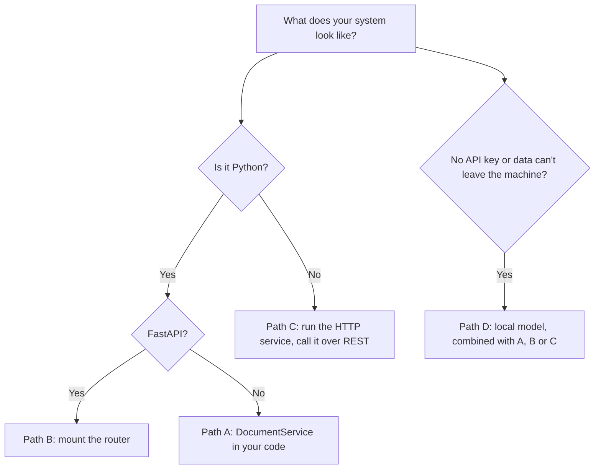
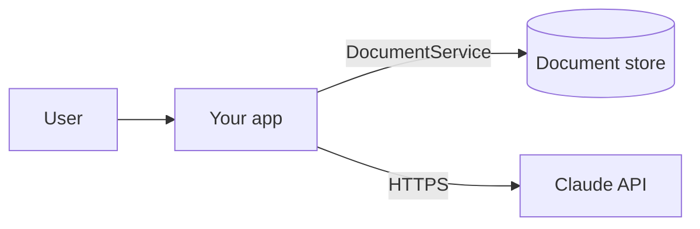
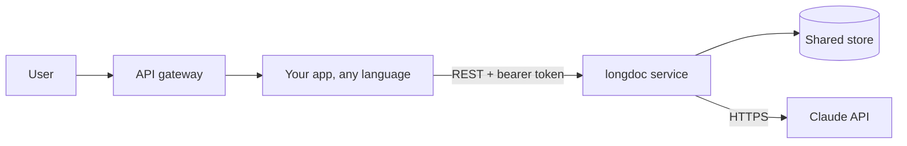
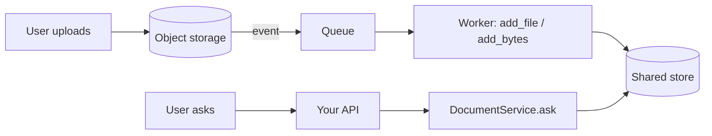

# Integration guide

How to add `longdoc-qa` to your own system, application or architecture, step by step.

**Contents**

1. [Choose your integration path](#1-choose-your-integration-path)
2. [Before you start](#2-before-you-start)
3. [Path A: Python library inside your app](#3-path-a-python-library-inside-your-app)
4. [Path B: Mount into an existing FastAPI app](#4-path-b-mount-into-an-existing-fastapi-app)
5. [Path C: Standalone service for any language](#5-path-c-standalone-service-for-any-language)
6. [Path D: Local model, no API key](#6-path-d-local-model-no-api-key)
7. [Architecture patterns](#7-architecture-patterns)
8. [Store documents in your own database](#8-store-documents-in-your-own-database)
9. [Choose a strategy and tune it](#9-choose-a-strategy-and-tune-it)
10. [Production checklist](#10-production-checklist)
11. [Test your integration](#11-test-your-integration)
12. [Troubleshooting](#12-troubleshooting)
13. [What has and hasn't been verified](#13-what-has-and-hasnt-been-verified)

---

## 1. Choose your integration path



| Path | Best for | You write | You run |
|---|---|---|---|
| **A. Library** | Django, Flask, Celery, Lambda, scripts | A few lines calling `DocumentService` | Nothing extra |
| **B. Mount in FastAPI** | An existing FastAPI app | One `include_router` call | Nothing extra |
| **C. Standalone service** | Node, Java, Go, .NET, PHP, mobile backends, no-code tools | An HTTP client call | One container |
| **D. Local model** | Air-gapped, no API key, data residency | A different client object | A model file on the same machine |

---

## 2. Before you start

You need:

- **Python 3.10+** for paths A, B and D, or **Docker** for path C.
- **A Claude credential**, unless you use path D. Set `ANTHROPIC_API_KEY` in the *server-side*
  environment (or run `ant auth login`). Never put it in a browser or mobile app.
- **Documents as text-based files** (`.pdf`, `.txt`, `.md`, `.rst`). Scanned PDFs have no text
  layer and need OCR first; the loader reports them as empty.
- **Permission to send the documents to the Anthropic API**, for paths A to C. Check this
  against your data policies. Path D sends nothing off the machine.

Install what you need:

```bash
pip install longdoc-qa                # library: text and Markdown
pip install "longdoc-qa[pdf]"         # + PDF support
pip install "longdoc-qa[server]"      # + HTTP API
pip install "longdoc-qa[local]"       # + local open-source models
pip install "longdoc-qa[all]"         # pdf + server
```

---

## 3. Path A: Python library inside your app

`DocumentService` manages many documents behind one thread-safe object and has no web-framework
dependency. Create **one per process** and reuse it.

**Step 1. Create the service once** (for example in `yourapp/services.py`):

```python
from longdoc import DocumentService, JSONFileStore, QAConfig

longdoc_service = DocumentService(
    store=JSONFileStore("/var/lib/yourapp/longdoc"),  # survives restarts
    config=QAConfig(effort="medium", max_parents=4),
)
```

**Step 2. Index a document when it arrives**, using your own primary key as the document ID so
the two stay linked (IDs are 1 to 64 characters of letters, digits, `_` or `-`):

```python
longdoc_service.add_bytes(upload.read(), filename=upload.filename, document_id="contract-1042")
# or: longdoc_service.add_file("/path/to/file.pdf", document_id="contract-1042")
# or: longdoc_service.add_text(text, document_id="contract-1042")
```

Indexing parses and chunks the file but makes **no model call**. Do it in a background task
for large files.

**Step 3. Ask questions:**

```python
from longdoc import answer_to_dict

answer = longdoc_service.ask("contract-1042", "What is the termination notice period?")
body = answer_to_dict(answer)  # JSON-ready dict for your own API response
print(answer.text)  # the answer
print([c.heading for c in answer.citations])  # sections it cites
print(answer.usage)  # tokens, including cache reads and writes
```

In async code use `await longdoc_service.aask(...)`.

**Step 4. Map errors to your own responses:**

```python
import anthropic
from longdoc import DocumentNotFoundError, LongDocError, RefusalError

try:
    answer = longdoc_service.ask(doc_id, question)
except DocumentNotFoundError:
    ...  # your 404
except RefusalError as exc:
    ...  # model declined; exc.category, exc.request_id
except LongDocError:
    ...  # bad input (empty question, unreadable file)
except anthropic.RateLimitError:
    ...  # your 429; the SDK already retried
except anthropic.APIError:
    ...  # your 502/503
```

**Step 5. Delete documents when your own record is deleted:** `longdoc_service.delete(doc_id)`.

Framework examples: [`examples/flask_integration.py`](../examples/flask_integration.py) and
[`examples/django_integration.py`](../examples/django_integration.py).

---

## 4. Path B: Mount into an existing FastAPI app

**Step 1.** `pip install "longdoc-qa[server]"`

**Step 2.** Create the service and include the router, behind **your own** authentication:

```python
from fastapi import Depends, FastAPI
from longdoc import DocumentService, JSONFileStore
from longdoc.server import create_router

service = DocumentService(store=JSONFileStore("./longdoc-data"))
app = FastAPI()
app.include_router(
    create_router(service),  # no api_key: your dependency authenticates
    prefix="/longdoc",
    dependencies=[Depends(your_existing_auth)],
)
```

**Step 3.** The routes appear under `/longdoc/v1/...` and in your app's `/docs` page. See
[section 5](#5-path-c-standalone-service-for-any-language) for the endpoint list.

Complete example: [`examples/fastapi_mount.py`](../examples/fastapi_mount.py).

---

## 5. Path C: Standalone service for any language

Run longdoc as its own service and call it over HTTP from anything.

**Step 1. Run it.** With Docker:

```bash
docker build -t longdoc .
docker run -p 8000:8000 \
  -e ANTHROPIC_API_KEY \
  -e LONGDOC_API_KEY=choose-a-long-random-token \
  -v longdoc-data:/data longdoc
```

Or without Docker:

```bash
pip install "longdoc-qa[all]"
export ANTHROPIC_API_KEY=... LONGDOC_API_KEY=choose-a-long-random-token
longdoc serve --store ./longdoc-data --host 0.0.0.0 --port 8000 --workers 4
```

`--workers` greater than 1 requires `--store`, so workers share documents.

**Step 2. Check it:** `curl http://localhost:8000/health` returns `{"status": "ok", ...}`. The
interactive docs are at `/docs` and the OpenAPI spec at `/openapi.json`.

**Step 3. Generate a typed client** for your language from `/openapi.json` with any OpenAPI
generator (for example `openapi-generator` or `openapi-typescript`), or call the endpoints
directly:

| Method | Path | Purpose |
|---|---|---|
| `GET` | `/health` | Liveness probe (no auth) |
| `POST` | `/v1/documents` | Upload a file (multipart: `file`, optional `id`) |
| `POST` | `/v1/documents/text` | Add a document as JSON `{"text", "source"?, "id"?}` |
| `GET` | `/v1/documents` | List documents |
| `GET` | `/v1/documents/{id}` | Document summary |
| `DELETE` | `/v1/documents/{id}` | Delete a document |
| `POST` | `/v1/documents/{id}/ask` | `{"question", "strategy"?, "include_context_text"?}` |
| `POST` | `/v1/documents/{id}/retrieve` | Preview the sections that would be sent (no model call) |

Every request except `/health` needs `Authorization: Bearer <LONGDOC_API_KEY>`.

**curl**

```bash
curl -H "Authorization: Bearer $LONGDOC_API_KEY" \
     -F file=@contract.pdf -F id=contract-1042 \
     http://localhost:8000/v1/documents

curl -H "Authorization: Bearer $LONGDOC_API_KEY" -H "Content-Type: application/json" \
     -d '{"question": "What is the termination notice period?"}' \
     http://localhost:8000/v1/documents/contract-1042/ask
```

**Node.js**

```js
const base = process.env.LONGDOC_URL;
const headers = { Authorization: `Bearer ${process.env.LONGDOC_API_KEY}` };

// upload
const form = new FormData();
form.append("file", new Blob([pdfBytes]), "contract.pdf");
form.append("id", "contract-1042");
await fetch(`${base}/v1/documents`, { method: "POST", headers, body: form });

// ask
const res = await fetch(`${base}/v1/documents/contract-1042/ask`, {
  method: "POST",
  headers: { ...headers, "Content-Type": "application/json" },
  body: JSON.stringify({ question: "What is the termination notice period?" }),
});
if (!res.ok) throw new Error((await res.json()).message);
const { text, citations, usage } = await res.json();
```

**Python (any client)**

```python
import httpx

client = httpx.Client(
    base_url=LONGDOC_URL, headers={"Authorization": f"Bearer {TOKEN}"}, timeout=120
)
client.post(
    "/v1/documents", files={"file": ("contract.pdf", pdf_bytes)}, data={"id": "contract-1042"}
)
answer = client.post(
    "/v1/documents/contract-1042/ask", json={"question": "What is the termination notice period?"}
).json()
```

**Step 4. Handle errors.** Every error body has the shape
`{"error": "<code>", "message": "...", "details": {...}}`:

| Status | `error` | What to do |
|---|---|---|
| 401 | `unauthorized` | Check the bearer token |
| 404 | `not_found` | The document ID doesn't exist (not uploaded, or deleted) |
| 413 | `too_large` | Upload over the size limit (`LONGDOC_MAX_UPLOAD_MB`, default 25) |
| 415 | `unsupported_format` | Use `.pdf`, `.txt`, `.md` or `.rst` |
| 422 | `invalid_document`, `invalid_request`, `refused` | Fix the input, or the model declined |
| 429 | `rate_limited` | Retry with exponential backoff |
| 502 / 503 | `upstream_error` / `upstream_unavailable` | Retry later; check the Claude API status |

**Configuration** (environment variables):

| Variable | Default | Purpose |
|---|---|---|
| `ANTHROPIC_API_KEY` | none | Claude credential |
| `LONGDOC_API_KEY` | none (unauthenticated, logs a warning) | Bearer token callers must send |
| `LONGDOC_STORE_DIR` | in memory | Where documents are kept; required for more than one worker |
| `LONGDOC_MODEL` | `claude-opus-5-5` | Claude model ID |
| `LONGDOC_EFFORT` | `medium` | `low`, `medium`, `high`, `xhigh`, `max` |
| `LONGDOC_STRATEGY` | `retrieval` | `retrieval` or `cached_document` |
| `LONGDOC_CACHE_TTL` | `5m` | `5m` or `1h` |
| `LONGDOC_FALLBACKS` | `default` | `none` to disable refusal fallbacks |
| `LONGDOC_MAX_UPLOAD_MB` | `25` | Upload size limit |
| `LONGDOC_RATE_LIMIT_PER_MIN` | unlimited | Max uploads plus questions per client address per minute (per process) |
| `LONGDOC_PROVIDER` | `anthropic` | `anthropic` or `openai` (then also set `LONGDOC_MODEL` and `OPENAI_API_KEY`; see [OPENAI.md](OPENAI.md)) |
| `LONGDOC_ENV_FILE` | none | Path to a `.env` file read at startup (values never logged) |
| `LONGDOC_LOCAL_MODEL` | none | Path to a GGUF model: answer locally instead of with Claude |
| `LONGDOC_LOCAL_CTX` | `16384` | Local model context window in tokens |

Any ASGI server works too: `uvicorn longdoc.server.asgi:app --workers 4`.

---

## 6. Path D: Local model, no API key

Run everything on open-source models on your own hardware. Nothing leaves the machine and there is
no per-token cost. Combine with path A, B or C.

**Step 1.** `pip install "longdoc-qa[local]"` (this compiles llama.cpp, so it needs a C++ compiler
and CMake).

**Step 2.** Download the models (about 2.4 GB for the answering model, 36 MB for search):

```bash
scripts/download_models.sh models
```

**Step 3.** Use a local client wherever a Claude client is accepted:

```python
from longdoc import BM25Retriever, DocumentService, EmbeddingRetriever, HybridRetriever, QAConfig
from longdoc.local import BGE_QUERY_PREFIX, LlamaCppClient, LlamaCppEmbedder

llm = LlamaCppClient("models/Phi-3.5-mini-instruct-Q4_K_M.gguf", n_ctx=16384)
embed = LlamaCppEmbedder("models/bge-small-en-v1.5-q8_0.gguf")

service = DocumentService(
    client=llm,
    config=QAConfig(model=llm.model_name, fallbacks=None),
    retriever_factory=lambda: HybridRetriever(
        BM25Retriever(), EmbeddingRetriever(embed, query_prefix=BGE_QUERY_PREFIX)
    ),
)
```

For the HTTP service: `LONGDOC_LOCAL_MODEL=models/Phi-3.5-mini-instruct-Q4_K_M.gguf longdoc serve`.

**Know the limits.** On a 4-core CPU, answers take about 1 minute. Small local models are less
accurate than Claude, and their citations and quotes need checking. Use `Strategy.RETRIEVAL`:
sending a whole 45k-token contract to a local model did not finish in 90 minutes on 4 cores.
Measured results are in [`benchmarks/contract_review/README.md`](../benchmarks/contract_review/README.md).

---

## 7. Architecture patterns

### Pattern 1: Embedded library

The simplest option. Your app calls `DocumentService` in-process.



Use when: one Python app, modest traffic. Watch out for: each app process builds its own
in-memory indexes, so use a shared store (file volume or database) when you run several processes.

### Pattern 2: Sidecar or internal microservice

Run longdoc as a service next to your apps (path C). Any language can call it.



Use when: several apps or languages need document Q&A, or you want one place to hold the Claude
credential, enforce limits and watch costs. Keep the service on a private network; only your
backends call it.

### Pattern 3: Asynchronous ingestion, synchronous questions

Parsing and chunking large PDFs can take seconds, so move it off the request path.



Use when: uploads are large or bursty. The worker calls `service.add_file(path, document_id=...)`;
your API calls `service.ask(...)`. Both use the same `DocumentStore`. Show the user a "processing"
state until the worker finishes.

### Pattern 4: Hybrid search in front of a vector database

If you already run a vector database, wrap it in the `Retriever` interface (two methods, `index`
and `search`) and pass it as `retriever_factory`. longdoc still handles chunking, prompts, citations
and caching. See [section 9](#9-choose-a-strategy-and-tune-it).

### Pattern 5: Fully offline deployment

Path D inside an air-gapped network: `LlamaCppClient` plus local embeddings, documents on local
disk, no outbound calls.

---

## 8. Store documents in your own database

`DocumentStore` has four methods. Store `chunked_to_dict(doc)` as JSON and rebuild it with
`chunked_from_dict`. A complete, runnable SQLite version (about 50 lines, standard library only) is
in [`examples/sqlite_store.py`](../examples/sqlite_store.py):

```python
from longdoc import DocumentService
from examples.sqlite_store import SQLiteStore  # copy the class into your own code

service = DocumentService(store=SQLiteStore("longdoc.db"))
```

For Postgres, keep the same four methods and store the JSON in a `JSONB` column; for S3 or Redis,
store it as an object or string value. Requirements for any store:

- `get` returns `None` for an unknown ID (never raises).
- `put` replaces an existing document atomically.
- It is safe to call from several threads, and from several processes if you run more than one.
- Validate IDs with `longdoc.store.validate_document_id` before using them in paths or queries.

---

## 9. Choose a strategy and tune it

| Question about your use case | Use |
|---|---|
| Few questions per document, or documents too big to send whole? | `retrieval` (default) |
| Many questions about the **same** document within minutes? | `cached_document` with `cache_ttl="5m"`, or `"1h"` if questions come further apart |
| First answer must be fast after upload? | `cached_document` and call `warm_cache()` after indexing |
| Local model? | `retrieval` only |

| Symptom | Setting to change |
|---|---|
| Answers miss a relevant clause | Raise `max_parents` (default 4) or `top_k_children` (default 12); use hybrid search |
| Prompts too large or costly | Lower `max_parents` or `max_context_chars` |
| Paraphrased questions miss ("vendor acquired" vs "change of control") | Add `EmbeddingRetriever` through `HybridRetriever`, or use `cached_document` |
| Answers get cut off | Check `answer.truncated`; raise `max_tokens` |
| Hard multi-clause reasoning | Raise `effort` to `high` |
| Cache never hits | See [Troubleshooting](#12-troubleshooting) |

Preview what would be sent without calling the model: `service.retrieve(doc_id, question)` or
`POST /v1/documents/{id}/retrieve`.

Tune chunking for unusual documents with `ChunkingConfig(parent_max_chars=..., child_max_chars=...,
child_overlap_chars=...)`.

---

## 10. Production checklist

**Security**

- [ ] `LONGDOC_API_KEY` set (or your own auth in front of a mounted router).
- [ ] TLS terminated in front of the service.
- [ ] The service is on a private network, reachable only by your backends.
- [ ] `LONGDOC_RATE_LIMIT_PER_MIN` set (questions spend tokens), plus a limit at your gateway.
- [ ] Per-user access to document IDs is checked in your app (longdoc has one shared token).
- [ ] `ANTHROPIC_API_KEY` lives in your secret manager, not in code or images.
- [ ] You have confirmed that sending these documents to the Anthropic API is permitted.
- [ ] Per-user authorisation is enforced **in your app**: longdoc authenticates callers, it does
      not know which of your users may see which document ID.

**Reliability**

- [ ] A persistent, shared `DocumentStore` (not `InMemoryStore`) if you run several processes.
- [ ] Clients retry `429`, `502` and `503` with exponential backoff.
- [ ] Client timeouts of at least 120 seconds; answers stream, but the HTTP call returns when the
      full answer is ready.
- [ ] Fallback behaviour in your UI when `RefusalError` / `refused` occurs.
- [ ] `fallbacks=None` if you run on Bedrock, Vertex AI or Foundry.

**Cost and quality**

- [ ] Log `answer.usage` and watch `cache_hit_ratio`.
- [ ] Show citations (section and page) to users, and link to the source page.
- [ ] For high-stakes decisions, keep a human in the loop: answers are model output.
- [ ] Re-run [`benchmarks/contract_review`](../benchmarks/contract_review/) or a similar test on
      **your own** documents and questions before relying on the results.

**Operations**

- [ ] `/health` wired into your liveness probe.
- [ ] The `longdoc` logger captured (`DEBUG`: request IDs and token usage; `WARNING`: truncation and
      missing authentication). Log `answer.request_id` to trace a call in Anthropic support.
- [ ] Back up the document store, or keep your source files so documents can be re-indexed.
- [ ] Pin the version (`longdoc-qa==0.7.0`) and read [`CHANGELOG.md`](../CHANGELOG.md) before upgrading.

---

## 11. Test your integration

longdoc takes any object that looks like the Anthropic client, so your tests can run offline and
free. The repository's own tests do this with a small fake: see
[`tests/conftest.py`](../tests/conftest.py) (`FakeClient`, `fake_message`).

```python
from longdoc import DocumentService
from tests.conftest import FakeClient, fake_message  # copy these into your test suite

service = DocumentService(client=FakeClient(fake_message("Ninety days [p0000].")))
service.add_text(
    "19.2 Termination\n\nEither party may terminate on 90 days notice.", document_id="t1"
)
answer = service.ask("t1", "Notice period?")
assert answer.citations[0].id == "p0000"
```

Check retrieval separately and for free with `service.retrieve(...)`: it needs no model.

Before go-live, run an end-to-end test on your own documents with a list of questions whose
answers you know. [`benchmarks/contract_review/run.py`](../benchmarks/contract_review/run.py) is a
working template: it uploads documents through the HTTP API, asks questions, and scores correctness,
citations, cost and speed.

---

## 12. Troubleshooting

| Problem | Likely cause and fix |
|---|---|
| `EmptyDocumentError` / HTTP 422 `invalid_document` on a PDF | A scanned PDF with no text layer. OCR it first. |
| `UnsupportedFormatError` / HTTP 415 | Unsupported extension, or `pypdf` missing: `pip install "longdoc-qa[pdf]"`. |
| `DocumentNotFoundError` / HTTP 404 | Wrong ID, or the service uses an in-memory store and restarted. Use a persistent store. |
| 404 right after upload when running several workers | Workers don't share a store. Set `LONGDOC_STORE_DIR` to a shared directory. |
| Answers say "not found" but the clause exists | Retrieval missed it. Check `service.retrieve(...)`; raise `max_parents`, add hybrid search, or use `cached_document`. |
| Citations missing | The model didn't cite. Check `answer.text`; `answer.context` still lists what was sent. |
| `cache_read_input_tokens` stays 0 | Not using `cached_document`; questions are further apart than `cache_ttl`; the prompt prefix changes between calls (custom `system_prompt` with timestamps); or the document is below the model's minimum cacheable size. |
| HTTP 401 from your own calls | Missing or wrong `Authorization: Bearer ...` header. |
| 429 / 503 under load | Claude rate limits. Add client backoff, lower concurrency, or request higher limits. |
| `ContextWindowExceededError` | Local model context too small for the prompt. Use `retrieval`, or lower `max_parents`. |
| Server prints "running WITHOUT authentication" | `LONGDOC_API_KEY` is not set. |
| `pip install "longdoc-qa[local]"` fails | Needs a C++ compiler and CMake to build llama.cpp. |

---

## 13. What has and hasn't been verified

Be clear about what the evidence supports before you depend on this:

**Verified**

- The test suite (108 tests, 94% coverage), linting and strict type checks pass on Python 3.13.
- The HTTP service starts, authenticates, uploads, indexes and retrieves (exercised with a real
  server process and `curl`).
- The full contract-review benchmark ran through the real HTTP API on a **local open-source
  model**: 15 of 16 questions correct with hybrid search, 14 of 16 with keyword-only search.

**Not verified yet**

- **Live calls to the Claude API.** No API key was available during development, so the Claude
  code path is covered by tests with a fake client only. Run a small test with your own key
  before relying on it.
- **Prompt caching savings** (`cached_document`) have not been measured against the real API.
- The **Dockerfile** has not been built, and the **Flask and Django examples**, and the Node.js
  and Python client snippets in section 5, have not been run (the `curl` calls were).
- **Python 3.10 to 3.12.** CI runs them; they were not run locally.
- **Accuracy on your documents.** The benchmark uses synthetic contracts. Measure on yours.
